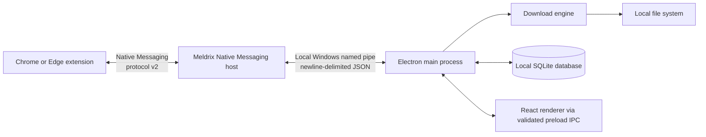

# Meldrix Download Manager

<div align="center">

### A Windows desktop download manager with optional Chrome and Microsoft Edge integration

[Project repository](https://github.com/fahadmia20333/download-manager) · Windows · Electron · React · TypeScript

</div>

> **Release status:** A GitHub check found no `v1.0.0` release or tag at the project repository when this README was prepared. The setup and portable download links are therefore not advertised as available. Check the [repository](https://github.com/fahadmia20333/download-manager) for published releases.

## About Meldrix Download Manager

Meldrix is a Windows desktop application for adding, organizing, and monitoring downloads. Its optional Manifest V3 extension hands supported browser downloads and detected media links to the desktop app through Chrome/Edge Native Messaging.

The application is built with Electron, React, TypeScript, and a local SQLite database. Download records and settings are stored on the computer. No Meldrix cloud account is required.

## Key Features

- Add HTTP or HTTPS URLs directly or send supported items from Chrome and Edge.
- Queue downloads and view task status, progress, and transfer speed.
- Pause and resume direct-file downloads when the server supports HTTP byte ranges.
- Retain task records and settings locally in SQLite.
- Choose a destination folder and organize tasks by detected file category.
- Receive desktop notifications when downloads complete.
- Use the system tray to show the app and start or stop the queue.
- Optionally detect supported browser downloads and HTML media through the extension.

## Screenshots

No screenshots are currently included in the repository.

## Installation

### Windows Installer

A GitHub Release `v1.0.0` has been created, but the Windows installer and portable executable assets must be uploaded manually through the GitHub web interface. The release notes and source code are available; the EXE files will be published once assets are uploaded.

For immediate use, the application can be built locally:

```powershell
npm run build-native-host
npm run dist
```

This produces `release/MeldrixDownloadManager-Setup.exe` and `release/MeldrixDownloadManager-Portable.exe` from the local build.

Once the GitHub Release assets are uploaded, direct download links will be available from the release page.

### Portable Version

Same as the Windows Installer — the portable executable is built locally and can be extracted to any location. The release assets will be available from the GitHub Release page once uploaded.

### Browser Extension Setup

After installing or building the desktop app:

1. Start Meldrix and open **Settings → Browser Integration → Open extension folder**. This opens the extension bundled with the app.
2. In Chrome, open `chrome://extensions`; in Edge, open `edge://extensions`.
3. Turn on **Developer mode**, select **Load unpacked**, and choose the opened `extension` folder.
4. Open the Meldrix extension popup. It reports a connection only after a real Native Messaging handshake with the desktop app.

The Windows installer registers the Native Messaging host for the current Windows user. For the portable build, keep a copy of the extension folder outside the portable app's temporary extraction location, then load that copy unpacked. The installer is the simpler option for browser integration when a published installer is available.

## Browser Integration

### Chrome

The extension uses Chrome's Manifest V3 APIs, including `nativeMessaging`, `downloads`, `webRequest`, and page scripting for media detection. Load the bundled extension unpacked as described above.

### Microsoft Edge

The same extension is compatible with Chromium-based Microsoft Edge. Load it from `edge://extensions`. The Windows installer registers the host for both Chrome and Edge.

### Native Messaging Architecture

The browser starts the Native Messaging host when it connects. The host can start Meldrix when needed and passes requests to the Electron main process over a local Windows named pipe. The application acknowledges an enqueue request only after accepting it.

The bridge uses protocol version 2. Browser-to-host messages use Chrome/Edge's length-prefixed JSON framing; host-to-desktop messages use newline-delimited JSON. Requests are validated, correlated, retried within bounded limits, and deduplicated. No network service or localhost web dashboard is used for this bridge.

## How It Works

1. A user adds a web URL in Meldrix or invokes the extension on a supported browser download or media item.
2. The extension sends the selected URL and relevant metadata (such as filename, MIME type, size, referrer, and selected quality) over Native Messaging.
3. Meldrix either opens a review dialog or starts the request, depending on the **Confirm before downloading** setting.
4. The Electron main process runs the download, reports progress to the React interface, and writes the task record to local storage.
5. Downloaded content is saved in the chosen destination folder.

## Supported Download Types

| Type | Support |
| --- | --- |
| Direct HTTP/HTTPS files | Supported; the remote server must permit access. |
| Common documents, archives, installers, images, audio, and video files | Detected by URL, MIME type, or browser download metadata; actual availability depends on the source. |
| HLS video on demand | Unencrypted VOD playlists are supported. A master playlist is resolved to a variant and its segments are concatenated to a local `.ts` or `.mp4` file without remuxing. |
| Progressive DASH | Only a direct progressive rendition can be downloaded when detected. |
| Segmented DASH | Not supported; it requires muxing that this build does not provide. |
| Encrypted/live HLS, DRM, and protected streams | Not supported. Meldrix does not bypass access controls. |

The extension can show discovered media formats and quality choices where the page exposes them. It does not create quality variants that are not present in the source. A direct file may offer only **Original quality**.

## Download Management Features

- **Queue:** Tasks can be added to the queue or started immediately. The queue scheduler starts queued items while fewer than three downloads are active.
- **Pause and resume:** Direct-file downloads use a partial file and an HTTP `Range` request to continue when the server supports ranges. If the server does not honor a range request, the engine restarts the file transfer rather than appending an invalid response.
- **HLS pause behavior:** HLS downloads are written as a concatenated stream; pausing and resuming restarts that stream from the beginning.
- **History:** Task records, statuses, and settings persist locally. Deleting a task record does not delete the completed or partial file.
- **Progress:** The interface displays status, bytes, speed, and estimated time remaining when enough information is available.
- **Notifications and tray:** Completion notifications use Windows/Electron notifications. The tray can show the window, start the queue, or stop active downloads.
- **Not implemented:** Per-task multi-connection downloads and speed limits are not provided by the current engine.

## Architecture Overview



The renderer does not receive Node.js or direct filesystem access. It calls a limited preload API; Electron main-process handlers perform the privileged work. The database stores task metadata and application settings. Downloaded files are saved separately in the selected folder.

## Technology Stack

| Area | Technology |
| --- | --- |
| Desktop shell | Electron |
| User interface | React and TypeScript |
| Local persistence | SQLite through `sql.js` |
| Browser integration | Chrome/Edge Manifest V3 extension |
| Browser-to-desktop bridge | Native Messaging host and Windows named pipe |
| Packaging | `electron-builder` for Windows NSIS and portable targets |

## Project Structure

```text
electron/       Electron main process and preload bridge
extension/      Manifest V3 browser extension
native-host/   Native Messaging host and build/install scripts
src/            React and TypeScript renderer
build/          Windows installer customization
release/        Local packaging output (created by build commands)
```

## Development Setup

You need Windows, Node.js, and npm. From the project root, install dependencies:

```powershell
npm install
```

Run the Vite renderer and Electron app in development mode:

```powershell
npm run dev
```

The project does not define a separate extension build command. The extension is loaded unpacked directly from the `extension/` directory. For local Native Messaging registration, the existing helper is:

```powershell
npm run native-host
```

## Build Instructions

Build the renderer and run the TypeScript project build:

```powershell
npm run build
```

Build the Native Messaging executable:

```powershell
npm run build-native-host
```

Build both Windows distribution targets (NSIS installer and portable):

```powershell
npm run dist
```

To build just one Windows target:

```powershell
npm run dist:installer
npm run dist:portable
```

The commands write artifacts to `release/`. These are local build outputs, not evidence that a GitHub release has been published.

## Troubleshooting

### The extension cannot connect to Meldrix

- Open the desktop app and the extension popup again; the extension attempts bounded reconnection automatically.
- Check the connection and host status in **Settings → Browser Integration**.
- Reload the unpacked extension after reinstalling or updating Meldrix.
- Confirm that the extension was loaded from the bundled `extension` folder and that its manifest key was not changed.

### The Native Messaging host is not registered

Run the Windows installer again, then reload the extension in Chrome or Edge. The installer registers the host for the current Windows user. For development, `npm run native-host` registers the locally built host.

### The desktop application is not running

The Native Messaging host normally starts Meldrix when a browser request needs it. If launch recovery fails, start Meldrix manually and retry. Check the app log from its application data directory if the problem continues.

### The browser extension is not detected

Make sure the extension is enabled and loaded unpacked from the correct `extension` folder. The installer is recommended for a stable host registration. With the portable build, load an external copy of the extension folder rather than one inside a temporary extraction directory.

### A download fails or cannot resume

- Confirm that the source URL is reachable and that the server permits the request.
- Resume depends on server support for HTTP byte ranges. Some servers require a fresh download.
- Browser requests that require cookies or authorization headers are not transferred with those credentials.
- HLS resumes from the beginning; it does not continue at the last segment.

### Windows SmartScreen displays a warning

The current installer is not code-signed. Windows may show a reputation warning for an unsigned build. Only install a release obtained from the official repository after a release has been published.

### HLS or DASH media is unavailable

Only unencrypted HLS VOD is supported. Live or encrypted HLS, DRM, and segmented DASH requiring muxing are not supported. Use a direct, authorized file or progressive rendition when the source offers one.

## Security and Privacy

- Download records and settings are stored locally; downloaded files remain in their chosen destination. The application does not require an account or provide a cloud-sync service.
- The extension sends the selected URL and relevant request metadata to the desktop app. It does not forward browser cookies, authorization headers, or session storage.
- A referrer may be passed to the download engine for sources that require it. Only use the app with content you are authorized to access.
- Electron uses context isolation and disables renderer Node.js integration. Privileged operations are exposed through a limited preload API and validated main-process handlers.
- No claim is made that local database contents are encrypted.
- Meldrix does not bypass DRM, authentication, paywalls, or other access controls.

## Known Limitations

- No verified GitHub release assets were found for the supplied `v1.0.0` release URLs at the time of writing.
- Multi-connection downloads and speed limits are not implemented.
- Resume depends on HTTP range support; HLS resume restarts from the beginning.
- HLS output is concatenated without remuxing, so playback or seeking compatibility can vary.
- Live/encrypted HLS, DRM-protected content, and segmented DASH requiring muxing are unsupported.
- Browser requests requiring session cookies or authorization headers cannot be handed off with those credentials.
- The Windows installer is unsigned and may trigger SmartScreen warnings.

## Roadmap

No public roadmap or delivery dates are published. Potential work should be tracked as an issue or discussion in the [project repository](https://github.com/fahadmia20333/download-manager); items are not represented as committed features here.

## Contributing

Contributions are welcome. Before making a substantial change, open an issue in the [repository](https://github.com/fahadmia20333/download-manager) to discuss scope. Include the Windows version, reproduction steps, and relevant non-sensitive logs when reporting a bug. Do not attach credentials, cookies, private URLs, or personal download files.

## License

No `LICENSE` file was found in the repository when this README was reviewed. Until a license is published, the project should not be assumed to grant permission to copy, modify, or redistribute its code.

## Support and Contact

- **Issues and feature requests:** [GitHub Issues](https://github.com/fahadmia20333/download-manager/issues)
- **Project updates and releases:** [GitHub repository](https://github.com/fahadmia20333/download-manager)
