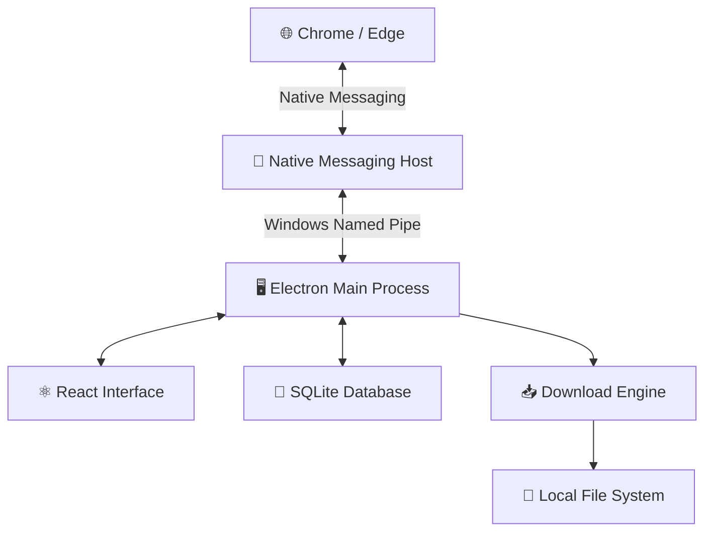

# 🪟 Meldrix Download Manager

<div align="center">

### A Powerful, Modern & Lightweight Windows Download Manager

**Manage downloads. Capture browser downloads. Organize everything in one place.**

<br>

[](https://www.microsoft.com/windows)
[](https://www.electronjs.org/)
[](https://react.dev/)
[](https://www.typescriptlang.org/)

<br>

**[⬇️ Download for Windows](#-download)** · **[✨ Features](#-features)** · **[📖 Installation](#-installation)** · **[🛠️ Development](#️-development-setup)**

</div>

---

## 📥 Download

Get Meldrix Download Manager for Windows.

<div align="center">

### GitHub Releases

See the [published GitHub Releases](https://github.com/fahadmia20333/dawnload-manager/releases). The current published release has no downloadable assets.

| 🖥️ Edition | 📦 Download |
|:---|:---|
| **Windows Installer (Setup)** | Not published yet |
| **Portable Edition** | Not published yet |

### AWS S3 Archives

| 📦 Archive | Download |
|:---|:---|
| **ZIP archive** | Not published yet |

</div>

> **⚠️ Windows SmartScreen:** The application is currently unsigned. Windows may display a security or reputation warning when launching the installer. Only download it from the official project release.

---

## 🚀 About Meldrix

Meldrix Download Manager is a standalone Windows application designed to make downloading and managing files easier.

Built with **Electron, React, TypeScript, and SQLite**, Meldrix combines a modern desktop interface with optional Google Chrome and Microsoft Edge integration.

Its browser extension communicates directly with the desktop application through **Native Messaging**. This allows supported browser downloads and detected media links to be sent to Meldrix without requiring a permanent localhost server or cloud account.

### Why Meldrix?

- 🖥️ Standalone Windows desktop application
- 🌐 Chrome and Microsoft Edge integration
- ⚡ Direct HTTP/HTTPS downloads
- ⏸️ Pause and resume support where the server allows it
- 📂 Custom download locations
- 🗂️ Organized download management
- 🎬 Detection of supported browser media
- 💾 Local SQLite persistence
- 🔒 No mandatory cloud account

---

## ✨ Features

### 📥 Download Management

- Add HTTP and HTTPS download URLs.
- Monitor download progress in real time.
- View download speed and estimated remaining time.
- Pause and resume supported direct-file downloads.
- Manage queued and active downloads.
- Save files to a selected destination folder.
- Organize downloads by detected file category.

### 🌐 Browser Integration

- Chrome and Microsoft Edge support.
- Manifest V3 browser extension.
- Native Messaging communication.
- Send supported browser downloads to Meldrix.
- Detect supported media links on web pages.
- Display available media formats and quality choices when exposed by the source.
- Automatically launch the desktop application when required.

### 🎬 Media Detection

- Detect supported HTML media.
- Discover HLS VOD playlists.
- Identify available media variants.
- Display source-provided quality choices.
- Handle supported progressive media downloads.

**Note:** Meldrix does not invent video qualities. Available choices depend on the formats actually exposed by the source.

### 🖥️ Desktop Experience

- Modern React-based interface.
- System tray integration.
- Desktop completion notifications.
- Persistent download history.
- Local application settings.
- Custom download folder selection.

---

## 📸 Screenshots

Screenshots will be added here as the project interface evolves.

---

## 📖 Installation

### 1. Windows Setup Installer (Not published yet)

The installer is not available in the published GitHub release yet. Check the [GitHub Releases](https://github.com/fahadmia20333/dawnload-manager/releases) page for future published assets.

### 2. Portable Edition (Not published yet)

The portable executable is not available in the published GitHub release yet. Check the [GitHub Releases](https://github.com/fahadmia20333/dawnload-manager/releases) page for future published assets.

For browser integration, copy the bundled `extension` folder from the application's resources to a permanent location before loading it into your browser.

### 3. Browser Extension Setup

**Google Chrome**

1. Open `chrome://extensions`.
2. Enable **Developer mode**.
3. Click **Load unpacked**.
4. Select the Meldrix `extension` folder.
5. Make sure the extension is enabled.

**Microsoft Edge**

1. Open `edge://extensions`.
2. Enable **Developer mode**.
3. Click **Load unpacked**.
4. Select the Meldrix `extension` folder.
5. Make sure the extension is enabled.

After setup, open the Meldrix extension popup. It should report a connection after a successful Native Messaging handshake.

> **Tip:** The Windows installer is recommended for browser integration because it automatically registers the Native Messaging host for the current Windows user.

---

## 🌐 Browser Integration Architecture

Meldrix uses the browser's native messaging system instead of a permanent local web server.



### How Native Messaging Works

1. The browser extension communicates with the Native Messaging host.
2. The host launches the desktop application when necessary.
3. The host forwards requests to the Electron main process through a local Windows named pipe.
4. The desktop application validates and processes incoming requests.
5. The extension receives an acknowledgement after the application accepts the request.

The bridge uses protocol version 2, request identifiers, bounded retries, and duplicate-request protection.

No permanent localhost HTTP server is required for this communication.

---

## 🎞️ Supported Download Types

| Format / Type | Support | Details |
|:---|:---:|:---|
| HTTP / HTTPS files | ✅ | Direct file downloads |
| Documents and PDFs | ✅ | Supported direct file URLs |
| ZIP and archive files | ✅ | Supported direct file URLs |
| Images | ✅ | Supported direct file URLs |
| Audio and video files | ✅ | Supported direct file URLs |
| HLS VOD | 🟡 | Unencrypted VOD playlists |
| Progressive DASH | 🟡 | Direct progressive renditions only |
| Segmented DASH | ❌ | Not currently supported |
| Live HLS | ❌ | Not currently supported |
| Encrypted HLS | ❌ | Not supported |
| DRM-protected media | ❌ | Not supported |

<sub>Support depends on the source server, available media formats, and access permissions.</sub>

### HLS Notes

Meldrix supports unencrypted HLS VOD playlists. A master playlist can be resolved to an available variant, and its segments are concatenated into a local `.ts` or `.mp4` file without remuxing.

HLS pause and resume currently restart the stream from the beginning.

---

## ⚙️ Download Management

| Feature | Description |
|:---|:---|
| Download Queue | Manage queued downloads |
| Pause / Resume | Resume direct downloads when HTTP Range is supported |
| Progress Tracking | Monitor bytes, speed, and remaining time |
| Download History | Keep task records locally |
| Folder Selection | Choose a custom download destination |
| Notifications | Receive completion notifications |
| System Tray | Access common application controls |
| SQLite Storage | Persist tasks and settings locally |

### Current Engine Limitations

- Per-task multi-connection downloads are not implemented.
- Download speed limits are not implemented.
- Direct-file resume depends on server HTTP Range support.
- HLS resume restarts the stream.
- HLS output is not remuxed.

---

## 🏗️ Technology Stack

| Component | Technology |
|:---|:---|
| Desktop Framework | Electron |
| Frontend | React |
| Programming Language | TypeScript |
| UI Development | Vite |
| Database | SQLite through sql.js |
| Browser Extension | Chrome / Edge Manifest V3 |
| Browser Communication | Native Messaging |
| Local Communication | Windows Named Pipe |
| Windows Packaging | electron-builder |

---

## 📁 Project Structure

```text
Meldrix-Download-Manager/
│
├── electron/
│   ├── Main process
│   └── Preload bridge
│
├── extension/
│   ├── Manifest V3 configuration
│   ├── Background service worker
│   └── Content scripts
│
├── native-host/
│   ├── Native Messaging host
│   └── Build and installation scripts
│
├── src/
│   └── React and TypeScript interface
│
├── build/
│   └── Windows installer resources
│
├── package.json
├── tsconfig.json
└── README.md
```

---

## 🛠️ Development Setup

### Requirements

- Windows 10 or Windows 11
- Node.js
- npm
- Git

### 1. Clone the Repository

```powershell
git clone https://github.com/fahadmia20333/dawnload-manager.git

cd dawnload-manager
```

### 2. Install Dependencies

```powershell
npm install
```

### 3. Start Development Mode

```powershell
npm run dev
```

### 4. Build the Native Messaging Host

```powershell
npm run build-native-host
```

For local Native Messaging host registration:

```powershell
npm run native-host
```

---

## 📦 Build Instructions

### Build the Application

```powershell
npm run build
```

### Build the Native Messaging Host

```powershell
npm run build-native-host
```

### Create Windows Installer and Portable Builds

```powershell
npm run dist
```

### Build Individual Packages

**Windows Installer:**

```powershell
npm run dist:installer
```

**Portable Edition:**

```powershell
npm run dist:portable
```

Build artifacts are generated in the `release/` directory.

---

## 🔧 Troubleshooting

### 🔴 Extension Cannot Connect to Meldrix

- Make sure Meldrix is installed and available.
- Open the desktop application manually.
- Check **Settings → Browser Integration**.
- Reload the browser extension.
- Verify that the extension is loaded from the correct folder.

### 🔴 Native Messaging Host Not Registered

- Re-run the Windows installer.
- Restart or reload the browser extension.
- For development builds, run `npm run native-host`.

### 🔴 Desktop Application Does Not Launch

- Start Meldrix manually.
- Retry the browser request.
- Check the application log in its application data directory.

### 🔴 Download Cannot Resume

Some servers do not support HTTP Range requests. In such cases, the application may need to restart the download.

### 🔴 Video Quality Is Not Available

Quality selection depends on the media formats exposed by the website. If the source only provides one direct file, Meldrix may show only the original quality.

---

## 🔐 Security & Privacy

Meldrix is designed to keep download management local to your Windows computer.

- No mandatory account registration.
- No required cloud storage or cloud synchronization.
- Download records and settings are stored locally.
- Downloaded files remain in the destination folder you select.
- The extension does not forward browser cookies, authorization headers, or session storage to the desktop application.
- Electron renderer Node.js integration is disabled, and context isolation is enabled.
- Privileged operations are handled through a limited preload API and validated main-process handlers.

### Responsible Use

Meldrix does not bypass:

- DRM protection
- Authentication requirements
- Paywalls
- Protected media restrictions
- Other website access controls

Only download content that you are authorized to access.

---

## ⚠️ Known Limitations

The current version has some limitations:

- Multi-connection downloads are not implemented.
- Per-download speed limits are not available.
- HLS resume restarts from the beginning.
- HLS output is concatenated without remuxing.
- Segmented DASH requiring muxing is unsupported.
- Live and encrypted HLS are unsupported.
- DRM-protected content is unsupported.
- Browser requests requiring cookies or authorization headers cannot be handed off with those credentials.
- The Windows installer is currently unsigned.

---

## 🗺️ Roadmap

Potential areas for future development:

- [ ] Multi-connection download support
- [ ] Per-download speed control
- [ ] Improved HLS pause and resume
- [ ] Better media compatibility
- [ ] Download scheduling improvements
- [ ] Additional download management options
- [ ] UI and accessibility improvements

*Roadmap items are development possibilities, not promises or currently available features.*

---

## 🤝 Contributing

Contributions, bug reports, and feature suggestions are welcome!

To contribute:

1. Fork the repository.
2. Create a feature branch.
3. Make your changes.
4. Test your changes.
5. Submit a Pull Request.

For substantial changes, open an issue first to discuss the proposed implementation.

When reporting bugs, include reproduction steps, Windows version, and relevant non-sensitive logs. Never share credentials, cookies, or private download URLs.

---

## 📄 License

A license file has not yet been published in the repository.

Until a license is added, do not assume that the project grants permission to redistribute, modify, or reuse its source code.

---

## 💬 Support & Community

Need help or found a bug?

- 🐛 **Bug Reports:** [Open an Issue](https://github.com/fahadmia20333/dawnload-manager/issues)
- 💡 **Feature Requests:** [Submit a Feature Request](https://github.com/fahadmia20333/dawnload-manager/issues)
- 📦 **Downloads:** [GitHub Releases](https://github.com/fahadmia20333/dawnload-manager/releases)
- 💻 **Source Code:** [GitHub Repository](https://github.com/fahadmia20333/dawnload-manager)

---

<div align="center">

## ❤️ Built for Better Downloads

**Meldrix Download Manager**

A modern Windows download experience.

<br>

<sub>Windows · Electron · React · TypeScript</sub>

</div>